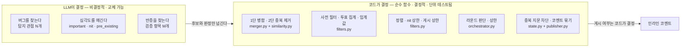
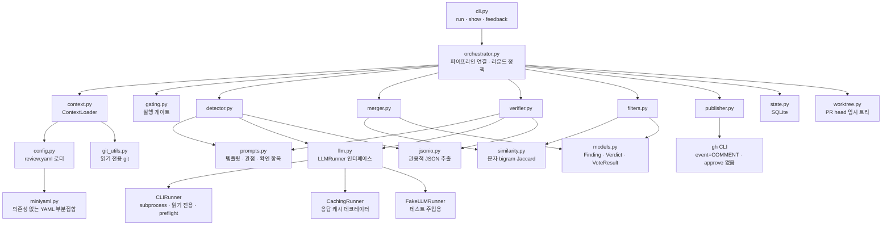
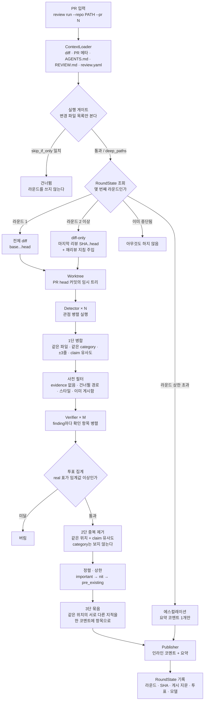
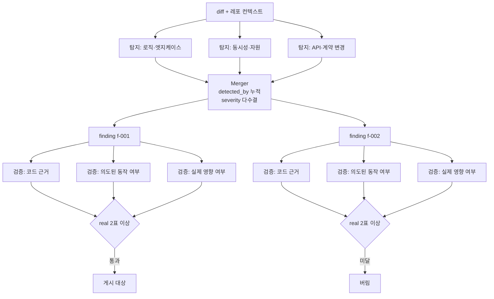
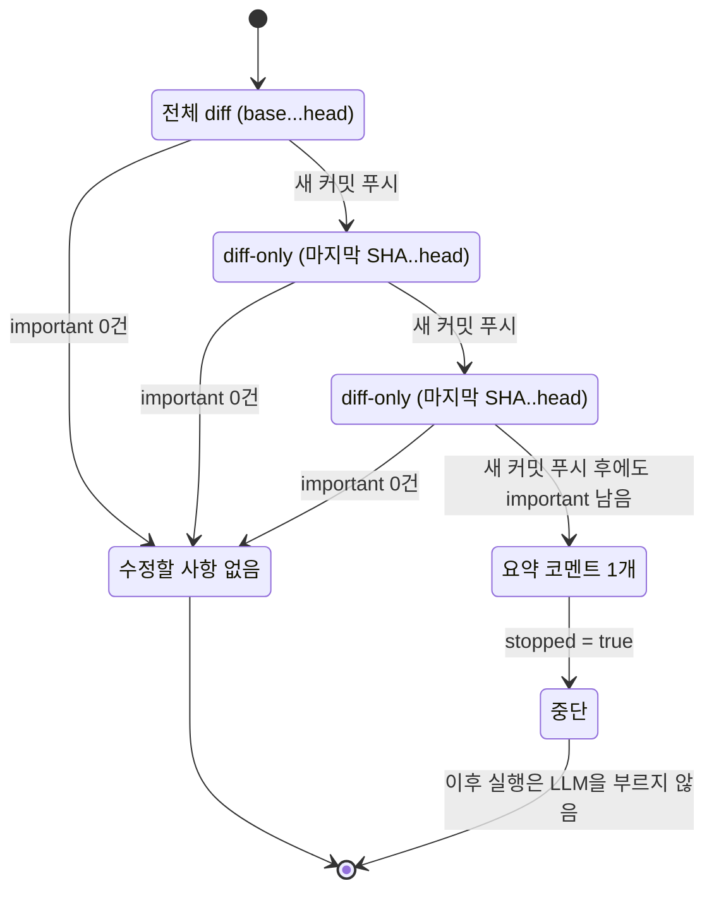
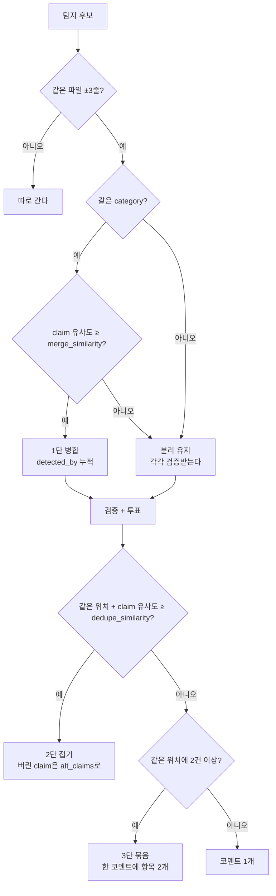

# pr-review-agent

> **넓게 찾고(병렬 탐지), 엄격하게 거른다(검증자 투표).**
> LLM이 찾은 지적을 LLM이 아니라 **코드가** 게시 여부를 결정하는 Pull Request 리뷰 에이전트.

1. [Project Overview](#1-project-overview)
2. [Problem](#2-problem)
3. [Key Features](#3-key-features)
4. **[Architecture](#4-architecture)**
5. [Tech Stack](#5-tech-stack)
6. **[Workflow](#6-workflow)**
7. [Getting Started](#7-getting-started)
8. [Configuration](#8-configuration)
9. [Example](#9-example)
10. **[Design Decisions](#10-design-decisions)**
11. [Future Improvements](#11-future-improvements)

---

## 1. Project Overview

PR 하나를 받아 **여러 관점으로 병렬 탐지 → 검증자 투표 → 중복 제거 → 인라인 코멘트 게시**까지
수행하는 코드 리뷰 에이전트입니다. GitHub Action으로 붙이거나 로컬에서 `review run`으로 돌립니다.

설계의 중심은 "LLM을 몇 번 부를까"가 아니라 **"LLM의 판단을 어디까지 믿을까"** 입니다.
버그를 찾고 심각도를 매기는 일은 LLM이 하지만, **무엇을 합칠지·버릴지·게시할지는 전부 순수
함수**가 결정합니다. 그래서 파이프라인의 핵심 로직은 LLM 없이 단위 테스트됩니다.

엔진은 범용입니다. 레포별 사정(스택, 컨벤션, 금지 API, 건너뛸 경로)은 **대상 레포의
`AGENTS.md` / `REVIEW.md` / `review.yaml`** 로만 들어옵니다. 오탐이 반복되면 엔진이 아니라
그 파일을 고칩니다.

- **우선순위**: ① 진짜 버그를 잡는다 ② 리뷰 라운드를 줄인다
- **비목표**: 지적 개수를 늘린다 · 스타일/포맷을 지적한다 · approve를 자동화한다

---

## 2. Problem

LLM에게 diff를 던지고 "리뷰해 줘"라고 하면 동작하는 코드는 30분이면 나옵니다.
실제 PR에 붙이면 네 가지가 터집니다.

| | 문제 | 왜 치명적인가 |
|---|---|---|
| ① | **오탐이 리뷰 전체를 무효화한다** | 10개 중 4개가 틀리면 리뷰어는 나머지 6개도 읽지 않는다. 코멘트를 읽히게 하는 비용은 "더 많이 찾기"가 아니라 "틀린 걸 안 올리기"다 |
| ② | **같은 버그가 코멘트 여러 개로 올라간다** | 관점을 나눠 병렬 탐지하면 같은 결함을 3개 관점이 다르게 서술한다. `파일:라인:category`로 중복 제거하면 탐지기가 라벨을 `data`/`concurrency`로 다르게 붙여 **그대로 통과**한다 |
| ③ | **에이전트가 작성자면 리뷰가 끝나지 않는다** | nit 하나가 수정 커밋 → 재리뷰 → 새 nit을 유발해 수십 라운드를 돈다. 수렴 장치가 없으면 무한 루프 |
| ④ | **같은 PR을 두 번 리뷰하면 결과가 다르다** | 모델 버전·개인 CLI 설정·워킹트리 상태·라운드 상태가 전부 결과를 바꾼다. 원인을 모르면 "프롬프트를 고쳐서 좋아진 건지" 판단할 수 없다 |

이 프로젝트의 목표는 ①~④를 **프롬프트 개선이 아니라 구조로** 푸는 것입니다.

---

## 3. Key Features

| 기능 | 내용 |
|---|---|
| **관점 분할 병렬 탐지** | 같은 프롬프트 N번이 아니라 서로 다른 관점(로직·동시성·API 계약) N개를 병렬 실행 |
| **검증자 투표** | finding마다 확인 항목이 다른 검증자 M명이 **반증을 찾고**, `real` 표가 임계값 이상일 때만 게시 |
| **3단 병합** | 검증 전 병합 → 검증 후 중복 제거 → 게시 시 묶음. 정체성을 `위치 + 주장 내용`으로 판단 |
| **라운드 수렴** | 라운드 2부터 diff 범위 축소 + 기존 지적 차단, 상한 초과 시 에스컬레이션 후 중단 |
| **보안 리뷰 (선택)** | 범용 관점 위에 덧붙는 보안 관점 + **다른 검증 항목** + 게시 슬롯 예약 |
| **실행 게이트** | LLM을 부르기 전에 변경 파일 목록만 보고 건너뛸지/강도를 올릴지 결정 |
| **결정성 제어** | 모델·추론 강도 고정, PR head 임시 worktree, 응답 캐시로 완전 재현 |
| **피드백 로그** | 게시한 finding과 투표 결과를 SQLite에 적재, 작성자 반응을 붙여 오탐률 측정 |

게시는 `event=COMMENT`까지만 합니다. **approve는 구현하지 않았고**, `--dry-run`이 기본값입니다.

---

## 4. Architecture

### 4.1 두 개의 레이어 — 코드가 결정하는 것 vs LLM이 결정하는 것

가장 중요한 구조적 선택입니다. **흔들리면 안 되는 로직은 LLM에 맡기지 않습니다.**



왼쪽은 전부 **입력 → 출력이 고정된 순수 함수**라 LLM 호출 없이 테스트 452개가 돕니다.
오른쪽은 비결정적이지만 **인터페이스 하나(`LLMRunner`)로만** 호출되므로 테스트에서는
`FakeLLMRunner`로 통째로 치환됩니다.

### 4.2 모듈 구조



### 4.3 LLM 교체 지점

탐지와 검증은 **인터페이스 하나(`LLMRunner.run(prompt, repo_path) → text`)로만** LLM을
부릅니다. API 키·HTTP 클라이언트·SDK가 **코드에 없습니다.** 구현체는 `CLIRunner`(실제 호출),
`CachingRunner`(캐시 데코레이터), `FakeLLMRunner`(테스트) 셋입니다.

`CLIRunner`는 백엔드 중립적입니다. 커맨드가 자리표시자(`{repo}` `{out}` `{model}` `{effort}`
`{stdin}`) 기반이라 **클래스가 아니라 데이터로** 백엔드를 바꿉니다 — 백엔드 추가 비용은
`BACKEND_PRESETS`에 항목 하나입니다.

### 4.4 레포별 컨텍스트 주입

엔진에는 프로젝트별 하드코딩이 없습니다. 네 파일 모두 없어도 기본값으로 동작합니다.

| 파일 | 쓰임 | 없으면 |
|---|---|---|
| `AGENTS.md` / `CLAUDE.md` | 프로젝트 소개·스택·빌드 명령·컨벤션. **프롬프트에 원문 주입** | 기본 지침으로 진행 |
| `REVIEW.md` | 리뷰 지침 원문 주입 + `## 건너뛸 경로`와 nit 상한은 **코드가 직접 파싱** | 기본값 (nit 3개) |
| `SECURITY-REVIEW.md` | 인증 방식·금지 API·알려진 예외. **보안 프롬프트에만** 주입 | 일반 통념으로만 판단 |
| `review.yaml` | N·M·임계값·상한·강도·보안 관점·실행 게이트 오버라이드 | 전부 기본값 (보안 꺼짐) |

### 4.5 데이터 모델

LLM이 내보내는 finding 스키마. `evidence`(파일:라인 + 코드 인용)는 **필수**이며 비어 있으면
스키마 검증에서 제거됩니다.

| 필드 | 값 |
|---|---|
| `file` / `line_start` / `line_end` | 레포 루트 기준 상대 경로 + 라인 범위 |
| `category` | `logic` · `concurrency` · `api_contract` · `security` · `data` · `other` |
| `severity` | `important` · `nit` · `pre_existing` |
| `claim` / `evidence` / `suggested_fix` | 주장 / 근거 코드(**필수**) / 수정 방향 |
| `detected_by` | 어떤 관점들이 찾았는지 (엔진이 기록) |

지문(fingerprint) = `파일:라인범위:category` — 라운드 간 중복 게시를 막는 키입니다.
상태는 **SQLite 파일 하나**(`.review-agent/state.db`)에 담깁니다 —
`pr_state`(라운드·마지막 SHA·중단 여부) / `posted_findings`(게시 이력 + 투표 결과) /
`feedback`(작성자 반응: `fixed` · `wrong` · `intentional` · `ignored`).

---

## 5. Tech Stack

| 선택 | 이유 |
|---|---|
| **Python 3.10+, 외부 의존성 0** | 리뷰 에이전트는 **남의 레포 CI에 얹히는** 도구다. 의존성이 하나 늘면 그 레포의 빌드가 깨질 확률이 는다. `review.yaml`은 내장 미니 파서로 읽고, PyYAML이 있으면 그것을 쓴다 |
| **LLM = CLI 서브프로세스** (`codex` / `claude`) | SDK를 쓰면 코드가 API 키를 들어야 한다. CLI에 맡기면 인증·모델 선택·샌드박스가 전부 CLI 책임이 되고 **비밀값이 코드와 로그에 남지 않는다** |
| **게시 = `gh` CLI** | 같은 이유로 토큰을 직접 다루지 않는다 |
| **상태 = SQLite (stdlib)** | 라운드·지문·투표·피드백이 모두 `(repo_key, pr_number)` 키의 관계형 데이터이고, CI에서 `actions/cache`로 **파일 하나만** 이어 붙이면 된다 |
| **git worktree** | PR head 시점의 파일을 얻는 가장 싼 방법. clone 없이 같은 오브젝트 DB를 공유한다 |
| **`unittest` (stdlib) + `FakeLLMRunner`** | 의존성 0을 유지. LLM 호출 없이 전체 파이프라인을 통합 테스트한다 |
| **문자 bigram Jaccard (직접 구현)** | 임베딩을 쓰면 LLM 호출과 비결정성이 또 는다. 9줄 함수로 충분했다 ([10.2](#102-유사도-임계값은-추측이-아니라-실측으로-정했다)) |

---

## 6. Workflow

### 6.1 전체 실행 흐름



### 6.2 탐지·검증 팬아웃

탐지기는 같은 프롬프트를 N번 돌리지 않고 **관점을 나눕니다.** 검증자는 탐지기의 추론 과정을
받지 않고 **finding 하나와 레포만** 받으며, 지적을 지지하는 대신 **반증을 찾도록** 지시받습니다.



**LLM 호출 수 = `N` + (병합 후 finding 수 × `M`)** — 기본값 3/3이면 후보 2건일 때 9회.
전부 `max_parallel`(기본 8) 안에서 병렬 실행됩니다.

| 탐지 관점 (N=3) | 보는 것 |
|---|---|
| `logic` 로직·엣지케이스 | 조건 분기 오류, null/경계값, 잘못된 계산, 오류 처리 누락, 상태 전이 |
| `concurrency` 동시성·자원 | 경쟁 상태, 트랜잭션 경계, 락/데드락, 리소스 누수, 재시도·멱등성 |
| `api_contract` API·계약 | 요청/응답 필드·타입 변경, 하위 호환 파괴, 호출부 불일치, 스키마·마이그레이션 |

| 검증 확인 항목 (M=3) | 보는 것 |
|---|---|
| 코드 근거 | 인용된 코드가 그 위치에 실제로 있는가, 주장이 그 코드로 성립하는가 |
| 의도된 동작 여부 | PR 설명·컨벤션·테스트에 비추어 의도된 동작이 아닌가, 다른 계층이 처리하지 않는가 |
| 실제 영향 여부 | 이 경로에 도달 가능한가, 도달하면 구체적 영향이 있는가 |

증거가 불충분하면 `not_real`, 출력이 파싱되지 않아도 `not_real`.
**애매하면 닫는 쪽이 기본값입니다.**

### 6.3 라운드 상태 머신

에이전트가 작성자이고 에이전트가 리뷰어이면 수십 라운드를 돌 수 있습니다. 상한이 필수입니다.



라운드 2 이상의 규칙:

- **범위 축소** — 마지막으로 리뷰한 커밋 이후의 diff만 본다
- **반복 금지** — 이미 게시한 지적은 **코드 필터와 프롬프트 양쪽**으로 막는다
- **회귀 우선** — 이번 커밋이 만든 문제와, 이전 지적을 고치다 생긴 회귀를 먼저 찾는다
- **묶어서 지적** — 같은 유형의 버그는 모든 인스턴스를 하나의 finding으로 묶는다
  (한 줄씩 여러 라운드에 걸쳐 지적하지 않게 하는 장치)

상한을 넘기면 개별 코멘트 대신 "접근 방식을 다시 검토해 보라"는 **요약 하나만** 남기고 그 PR을
중단합니다. 추적 지표로 PR별 **rounds-to-pass**를 기록합니다.

---

## 7. Getting Started

**요구사항** — Python 3.10+ (외부 의존성 없음), LLM 백엔드 CLI(`codex` 또는 `claude`),
`gh` CLI(PR 메타데이터·게시. 토큰은 `gh`가 관리).

```bash
pip install -e /path/to/pr-review-agent
npm install -g @openai/codex && codex login     # 로컬은 로그인만(구독 크레딧), 키는 환경에 두지 않는다

review run --repo ~/work/my-service --pr 163 --dry-run    # --dry-run이 기본값
review run --repo . --pr 163 --post                       # 게시는 --post를 명시해야 한다
review show --repo . --pr 163                             # 설정·라운드 상태 확인
review feedback --repo . --pr 163 --finding f-001 --reaction fixed
python3 -m unittest discover -s tests -t tests            # 테스트 452개
```

첫 LLM 호출 **전에** 실행 파일과 인증을 한 번 확인하고(preflight), 안 돼 있으면 리뷰를
시작하지 않고 백엔드별 조치를 알려줍니다.

**GitHub Action** — [`examples/github/pr-review.yml`](examples/github/pr-review.yml)을 대상
레포의 `.github/workflows/`로 복사합니다. 세 가지를 꼭 맞춰야 합니다.

1. `fetch-depth: 0` — `base...head` diff 계산에 전체 히스토리가 필요합니다.
2. **상태 파일 보존** — `.review-agent/state.db`가 실행 간에 남지 않으면 매 실행이 라운드 1이
   되어 이전 지적을 다시 올립니다. 예시는 `actions/cache`를 씁니다.
3. `ref: ${{ github.event.pull_request.head.sha }}` — `pull_request` 이벤트의 체크아웃 기본값은
   **머지 커밋**이라 명시하지 않으면 로컬과 결과가 갈립니다 ([10.7](#107-pr-head-커밋의-임시-worktree에서-리뷰한다)).

---

## 8. Configuration

`review.yaml`을 대상 레포 루트에 두면 자동으로 읽습니다. 전부 선택이고, 없으면 기본값입니다.

```yaml
detectors: 3          # N (탐지 관점 수)
verifiers: 3          # M (검증자 수)
pass_threshold: 2     # M명 중 real 최소 수
max_findings: 10
max_nits: 3
max_rounds: 3
intensity: standard   # quick | standard | deep
comment_language: ko

merge_similarity: 0.16    # 1단 병합(검증 전, 같은 category). 느슨하게
dedupe_similarity: 0.20   # 2단 중복 제거(검증 후, category 무시). 엄격하게
group_comments: true      # 같은 위치의 서로 다른 지적을 한 코멘트로

llm:
  backend: codex          # codex | claude
  profile: local          # local | ci (보통 생략 — 환경변수로 자동 감지)
  model: gpt-5.6-terra
  reasoning_effort: medium

# 보안 리뷰는 기본 꺼짐. 이 줄을 더하면 범용 관점 "위에 덧붙는다"
# security_angles: [authz, injection, data_exposure]

# 실행 게이트: LLM을 부르기 전에 변경 파일 목록만 보고 거른다
# gate:
#   always_review: [".github/workflows/", Dockerfile, "*.tf"]
#   skip_if_only: [docs/, "*.md"]
```

**강도 프리셋** — 호출 수와 호출당 추론 강도를 함께 정합니다. 명시한 키가 프리셋을 덮어씁니다.

| intensity | detectors | verifiers | pass_threshold | reasoning_effort |
|---|---|---|---|---|
| `quick` | 1 | 1 | 1 | `low` |
| `standard` | 3 | 3 | 2 | `medium` |
| `deep` | 3 | 5 | 3 | `high` |

**해석 우선순위** — CLI 플래그(`--backend` `--profile` `--model`) → `review.yaml` →
프리셋/자동 감지 순으로 먼저 적힌 쪽이 이깁니다. nit 상한만 예외로
`max_nits` → `REVIEW.md` 파싱값 → 기본값 3입니다.

**주요 CLI 옵션** — `--post`(실제 게시) · `--cache`(응답 캐시) · `--state`(상태 DB 경로) ·
`--no-worktree` · `--record-state` · `--post-when-empty`

**실행 게이트**에서 평가 순서는 `always_review`가 `skip_if_only`보다 **먼저**인 것이 핵심입니다.
CI 워크플로·Dockerfile·의존성 목록은 "문서/설정"처럼 보이지만 보안상 최우선 대상입니다.
건너뛴 실행은 라운드를 쓰지 않으므로 다음 푸시에서 다시 평가됩니다.

템플릿: [`examples/`](examples/) — `AGENTS.md` · `REVIEW.md` · `SECURITY-REVIEW.md` ·
`review.yaml` · GitHub Action 워크플로 · Spring Boot 서비스용 예시

---

## 9. Example

### 9.1 실제 PR에서 finding이 걸러지는 깔때기

PR #153 (Spring Boot 서비스, 13개 파일 +287/−4)을 `codex`로 리뷰한 실행 로그 값입니다.

| 단계 | 통과 | 무슨 일이 있었나 |
|---|---|---|
| 탐지 후보 | 9 | 관점 3개가 각각 보고 |
| 1단 병합 | 6 | 같은 버그를 여러 관점이 다르게 서술한 것을 합침 (`detected_by` 누적) |
| 사전 필터 | 6 | 건너뛸 경로·스타일 지적 없었음 |
| 투표 통과 | 6 | 전부 `real` 3/3 |
| **2단 중복 제거** | **5** | `AdminConfirmService:38-44`의 `@Transactional` 누락이 `data`/`concurrency`로 갈려 있던 것을 접음 |
| 정렬·상한 | 5 | 상한에 걸린 것 없음 |
| 게시 | 5 | 코멘트 5개 |

**그 중복 1건이 설계를 고치게 만든 사례입니다.** 이전 구현은 category를 정체성으로 썼기 때문에
같은 줄의 같은 문제를 코멘트 두 개로 올렸습니다 → [10.1](#101-병합을-3단으로-나눴다)

### 9.2 dry-run 출력

```console
$ review run --repo ~/work/my-service --pr 153 --dry-run

라운드 1
범위: PR 전체 diff를 봅니다
백엔드: codex / 프로필: local / 모델: gpt-5.6-terra / head a1b2c3d4e5f6
리뷰 트리: head 커밋의 임시 worktree
요약: Important 5 (코멘트 5개)
단계별: 탐지 후보 9 -> 1단 병합 6 -> 사전 필터 6 -> 투표 통과 6 -> 2단 중복 제거 5 -> 게시 5

=== 리뷰 결과 (라운드 1, dry-run) ===
Important 5
------------------------------------------------------------------------
[Important] f-002 AdminConfirmService.java:38-44 (concurrency)
탐지 관점: logic, concurrency
주장: 조회와 상태 변경이 서로 다른 트랜잭션에서 실행되어, 동시 요청이 같은 건을 두 번 승인할 수 있습니다.
근거: ConfirmBlockHistory history = repository.findById(id).orElseThrow();
      history.confirm();   // @Transactional 없음
제안: 메서드에 @Transactional을 붙이고 조회에 비관적 락을 걸거나, 상태 전이를 조건부 update로 바꾸세요.
  (다른 서술) 승인 처리에 트랜잭션 경계가 없어 중간 실패 시 일부만 반영됩니다.
------------------------------------------------------------------------
코멘트 5개 / 지적 5건
```

`alt_claims`에 보존된 다른 서술이 `(다른 서술)`로 함께 보입니다
([10.1](#101-병합을-3단으로-나눴다)의 불변식 ③).

### 9.3 실행 비용 (PR #153 실측)

| 설정 | LLM 호출 | 벽시계 시간 | 찾은 지적 |
|---|---|---|---|
| 기본 (`standard`) | 약 18회 | **5분 28초** | 5건 |
| `intensity: quick` | 3회 | **2분 43초** | 2건 |
| `--cache` 재실행 | **0회** | **1.2초** | 5건 (동일) |

**호출 수를 1/6로 줄여도 시간은 절반만 줄어듭니다.** 호출이 병렬로 돌기 때문에 벽시계 시간은
호출 수보다 **가장 느린 호출 하나**가 좌우합니다. 그리고 `quick`은 5건 중 2건만 찾았습니다 —
탐지기가 1개면 관점이 하나뿐이고, 검증자가 1명이면 투표가 필터 역할을 못 합니다.

---

## 10. Design Decisions

### 10.1 병합을 3단으로 나눴다

**문제.** `파일:라인:category`로 중복을 제거하면 실패합니다 — 탐지기가 같은 버그에
`data`/`concurrency` 라벨을 다르게 붙이면 그대로 통과해 코멘트가 둘 올라갑니다
([9.1](#91-실제-pr에서-finding이-걸러지는-깔때기)의 실제 사례).

**관찰.** 같은 결함인지 판단하는 신호는 셋인데 믿을 수 있는 정도가 다릅니다.

| 신호 | 믿을 수 있는가 |
|---|---|
| 파일·라인 위치 | 믿을 수 있다. 단 한 위치에 서로 다른 버그가 둘 있을 수 있다 |
| `category` | **믿을 수 없다.** 탐지기가 추측한 라벨이다 |
| `claim` 내용 | 믿을 수 있다. 단 표현이 달라 완전 일치를 기대할 수 없다 |

**선택.** 정체성을 **`위치 + 주장 내용`** 으로 정의하고 category는 보조로만 씁니다. 그리고
병합을 한 번에 끝내지 않고 **검증 전 / 검증 후 / 게시 시** 세 단계로 쪼갭니다.



**지키는 불변식 세 개.**

1. **정체성 = 위치 + 내용.** 위치만으로는 합치지 않는다.
2. **검증받지 않은 주장은 게시하지 않는다.** 그래서 서로 다른 주장을 검증 전에 섞지 않는다 —
   섞으면 검증자가 두 주장을 한꺼번에 판정해 투표가 흐려지고, 흡수된 주장은 검증 없이 실린다.
3. **코멘트 수는 줄이고 정보는 줄이지 않는다.** 어느 단계에서도 claim을 버리지 않는다
   (흡수된 것은 `alt_claims`로 코멘트에 함께 보인다).

**결과.** 네 경우가 모두 "코멘트 1개 또는 꼭 필요한 2개"로 떨어집니다.

| 경우 | 1단 | 2단 | 3단 | 결과 |
|---|---|---|---|---|
| 같은 버그, 같은 category, 다른 표현 | 합침 | - | - | 코멘트 1개, `detected_by` 누적 |
| 같은 버그, **다른 category** | 분리 | **접음** | - | 코멘트 1개 |
| **다른 버그, 같은 위치** | **분리** | 분리 | **묶음** | 코멘트 1개, 항목 2개 (둘 다 검증됨) |
| 다른 버그, 다른 위치 | 분리 | 분리 | 분리 | 코멘트 2개 |

3단이 **안전망**입니다. 유사도 임계값이 빗나가도 최악의 결과가 "한 코멘트 안에 비슷한 항목 둘"이고
"코멘트 둘"이 아닙니다. 그래서 임계값 선택의 위험이 낮습니다.

### 10.2 유사도 임계값은 추측이 아니라 실측으로 정했다

`claim`의 **문자 bigram Jaccard**를 씁니다. 한국어는 조사가 붙어 단어 Jaccard가 낮게 나옵니다
("트랜잭션이" vs "트랜잭션은"). 문자 bigram은 조사와 띄어쓰기 차이에 둔감합니다.

임계값은 **실제 PR 리뷰 결과 15쌍**(같은 버그 5쌍 / 다른 버그 10쌍)으로 측정했습니다
(`tests/fixtures_pr153.py`).

| 비교 대상 | 같은 버그 최저 | 다른 버그 최고 | 간격 |
|---|---|---|---|
| claim만 | 0.243 | 0.122 | **+0.120** |
| claim + `suggested_fix` | 0.229 | 0.152 | +0.077 |

그래서 `suggested_fix`는 **비교에서 제외합니다** — "~하세요" 같은 상투적 문구가 서로 다른
버그끼리도 비슷해 보이게 만들어 간격을 절반 가까이 좁힙니다.

**배운 것.** 설계 단계에서 추측한 값은 **0.55**였습니다. 그대로 썼다면 실측 0.243을 한참 넘어
**아무것도 접히지 않았을 것**입니다. 합성 예제로 맞춘 임계값은 현장에서 쓸모가 없습니다.
(한국어 claim 기준이므로 `comment_language`를 바꾸면 다시 재야 합니다. `dedupe_similarity`가
`merge_similarity`보다 작으면 설정 로더가 거부합니다 — 2단이 1단보다 엄격해야 하므로.)

### 10.3 판단을 코드와 LLM으로 쪼갰다

LLM에게 "중복을 합쳐 줘", "중요한 것만 남겨 줘"까지 맡기면 같은 입력에 다른 리뷰가 나오고,
그 로직은 테스트할 수 없습니다. 그래서 병합·중복 제거·필터·투표 집계·정렬·상한·라운드 판단을
**전부 순수 함수로** 내렸습니다 ([4.1](#41-두-개의-레이어--코드가-결정하는-것-vs-llm이-결정하는-것)).

결과로 **테스트 452개가 LLM 없이** 돕니다. 전체 파이프라인도 `FakeLLMRunner` 주입으로 통합
테스트되므로, 프롬프트를 고쳤을 때 "파이프라인이 깨진 건지 프롬프트가 나빠진 건지" 구분할 수
있습니다. `orchestrator.plan_round` / `plan_publish`, `config.resolve_llm`도 순수 함수입니다 —
`resolve_llm`은 `env`를 주입받아 테스트가 실제 환경변수를 건드리지 않습니다.

### 10.4 검증자에게 탐지 근거를 주지 않고, 반증을 찾게 했다

같은 LLM에게 "이 지적이 맞나?"라고 물으면 대체로 "맞다"고 합니다. 탐지기의 추론 과정까지
주면 그 추론에 끌려갑니다.

그래서 검증자는 **finding 하나와 레포만** 받고, 지적을 지지하는 대신 **반증을 찾도록**
지시받습니다. 확인 항목은 검증자마다 다릅니다 — 같은 질문을 M번 하는 것이 아니라 **다른 질문을
한 번씩** 합니다. 기본값은 닫는 쪽입니다(증거 불충분·파싱 실패·애매함 → 전부 `not_real`).
놓치는 버그보다 틀린 코멘트가 비싸다고 판단했습니다 ([2](#2-problem) ①).

### 10.5 보안 지적은 다른 검증 항목을 쓴다

**문제.** 범용 검증 항목을 보안에 그대로 쓰면 **취약점이 전부 떨어집니다.**
"의도된 동작 여부"는 범용 리뷰에서 훌륭한 오탐 필터입니다 — **버그는 정의상 의도하지 않은
동작**이니까요. 취약점은 반대로 거의 전부 **의도적으로 작성된, 지금 정상 동작하는 코드**입니다.
일부러 인증을 뺀 내부 엔드포인트, 바인딩이 안 되는 `ORDER BY`의 문자열 결합, 디버깅용 토큰
로깅이 모두 "의도된 동작"으로 판정되어 떨어집니다.

**선택.** `category: security` finding은 **도달 가능성 / 기존 방어 존재 / 악용 영향**으로
검증합니다. 오탐 필터가 없어지는 게 아니라 **"기존 방어 존재"(이 경로를 막는 방어가 코드에
있는가)가 그 자리를 맡습니다.** 이게 빠지면 "모든 문자열 결합은 인젝션"이 되어 노이즈가
폭발합니다.

| | 범용 | 보안 |
|---|---|---|
| 판단 기준 | 지금 잘못 동작하는가 | 공격자가 악용할 수 있는가 |
| 검증 항목 | 코드 근거 / 의도된 동작 / 실제 영향 | 도달 가능성 / 기존 방어 / 악용 영향 |
| 통과 기준 | `pass_threshold` (기본 2/3) | 기본 **전원 합의** |
| 게시 상한 | 정렬 순서대로 자름 | `security_reserved_slots`만큼 먼저 확보 |

**투표가 아니라 AND.** 세 항목은 독립적인 **필요조건**이라 통과 기준이 전원 합의이고,
`intensity: deep`으로 `verifiers`를 5로 올려도 보안 검증은 3명 그대로입니다 — 같은 항목을 두 번
뽑으면 그 항목에 가중치가 실려 AND 의미가 깨집니다. 게시 단계도 다릅니다. 정렬만으로 자르면
`important`가 많은 PR에서 보안 지적이 조용히 잘리므로 슬롯을 먼저 떼어 줍니다.

**별도 워크플로로 분리하지 않은 이유**는 라운드 상태입니다. 분리하면 `(repo_key, pr_number)`
키가 충돌하고 범용·보안 사이 교차 중복 제거가 사라집니다.

### 10.6 LLM을 SDK가 아니라 CLI 서브프로세스로 부른다

API 키, HTTP 클라이언트, SDK가 **코드에 없습니다.** 얻은 것 셋:

1. **비밀값이 코드와 로그에 남지 않는다.** 인증은 CLI(`codex login`), 게시는 `gh`가 맡는다.
2. **읽기 전용을 CLI가 보장한다.** codex는 `--sandbox read-only`, claude는
   `--permission-prompts none` + `--disallowedTools Write,Edit,...`.
3. **백엔드 추가 비용이 데이터 한 줄이다.** 커맨드가 자리표시자 기반이라 `BACKEND_PRESETS`에
   항목을 하나 더하면 끝이다.

**대가.** 호출 하나하나가 **독립된 에이전트 실행**입니다. 매번 새 프로세스가 `AGENTS.md`와
`REVIEW.md`를 다시 읽고 `git diff`를 다시 돌립니다. 호출 간 공유 상태가 없어서 느립니다
([9.3](#93-실행-비용-pr-153-실측)). diff를 프롬프트에 밀어 넣으면 훨씬 빠르지만 **호출처를 직접
열어 보는 능력**을 잃습니다. 그 능력이 오탐을 줄이는 핵심이라 느린 쪽을 택했습니다.

**인증은 먼저 막습니다(preflight).** 인증 없이 호출하면 `exit 1`과 섞인 stderr만 남아 원인을
알 수 없습니다. 첫 호출 전에 실행 파일 존재 → 키/토큰 → (`ci`면 즉시 중단, `local`이면
`codex login status`) 순으로 확인합니다. 확인 커맨드 자체가 실패하면 **통과시킵니다** — 확인
수단의 문제로 리뷰를 막지 않습니다. 프로필(`local`/`ci`)을 따로 둔 이유도 인증 경로가 다르기
때문입니다. CI는 환경변수뿐이고 대화형 로그인을 할 수 없습니다.

**구조화 출력은 일부러 쓰지 않습니다.** codex-cli 0.167에 `--output-schema`가 있지만, 백엔드마다
지원 여부와 스키마 제약이 달라 **엔진이 특정 CLI 버전에 묶입니다.** 대신 "JSON만 출력"을
프롬프트로 강제하고, 실패 시 1회 재시도하며, 로그가 섞여도 **균형이 맞는 JSON 구간을 찾아**
파싱합니다(`jsonio.py`).

### 10.7 PR head 커밋의 임시 worktree에서 리뷰한다

`git diff base...head`는 히스토리에서 나오지만, 탐지 프롬프트는 "호출처와 연관 파일을 열어
보라"고 지시하므로 LLM은 **체크아웃된 파일**을 읽습니다. 둘이 다른 시점이면 인용 라인 번호가
diff와 어긋나 인라인 코멘트가 엉뚱한 줄에 붙고, 워킹트리가 바뀔 때마다 결과가 달라집니다.

**실측.** PR #153의 head와 당시 워킹트리는 **128개 파일 / +710 −518** 차이였습니다. 그 리뷰가
인용한 `ConfirmBlockHistory.java`는 4줄, `application.yml`은 3줄 달랐습니다.

그래서 PR head 커밋의 임시 worktree를 만들어 **거기서** LLM이 파일을 읽게 하고, **리뷰 규칙
문서는 원본 레포에서** 읽습니다. 리뷰 규칙은 "리뷰 대상 코드"가 아니라 "지금 적용할 규칙"이고,
커밋하지 않은 `REVIEW.md`도 읽혀야 하기 때문입니다(worktree에는 untracked 파일이 없습니다).

### 10.8 재현성: 통제 가능한 원인을 전부 끊고, 완전 재현은 캐시로 얻는다

같은 PR을 두 번 리뷰했을 때 결과가 달랐습니다. 원인을 하나씩 끊은 결과입니다.

| 비결정성 원인 | 대응 | 가능? |
|---|---|---|
| 모델 버전 / 추론 강도 변동 | `-c model=` · `-c model_reasoning_effort=` 고정 | ✅ |
| 사용자 개인 설정 상속 | 명시적 `-c`가 `~/.codex/config.toml`을 이김 (+ `--ignore-user-config`) | ✅ |
| 리뷰 대상 파일 상태 | PR head 커밋의 임시 worktree ([10.7](#107-pr-head-커밋의-임시-worktree에서-리뷰한다)) | ✅ |
| 라운드 상태 / 백엔드 변동 | A/B 비교 시 새 `--state` 파일 / 캐시 스코프에 `llm.backend` 포함 | ✅ |
| 실행 순서 | 순수 함수 + 정렬 타이브레이크에 `id`까지 포함 | ✅ |
| 완전 재현 | 응답 캐시 (`--cache`) → 재실행 시 LLM 호출 0회, 출력 동일 | ✅ |
| **샘플링(temperature)** | **Codex CLI에 노출 안 됨** (`temperature`/`top_p`/`seed` 키가 없음) | ❌ |

**모델을 고정하지 않으면 결과가 조용히 바뀝니다.** `-c model=`을 주지 않으면 사용자의
`~/.codex/config.toml`을 상속하므로, ChatGPT 앱에서 모델을 바꾸는 순간 리뷰 품질이 달라지고
그 사실이 어디에도 남지 않습니다. 그래서 기본값으로 둘 다 커맨드에 박고, 사용한 모델을 상태
DB에 함께 기록합니다. 남는 샘플링 분산을 흡수하는 장치가 **투표 임계값과 상한**입니다.

---

## 11. Future Improvements

| 항목 | 지금 상태 | 다음 단계 |
|---|---|---|
| **사고 기반 eval 세트** | 피드백 로그 구조만 준비됨 (finding 전문·투표·작성자 반응 적재) | 데이터가 쌓이면 오탐률을 측정하고 프롬프트/임계값 변경을 A/B로 검증. **재현성 작업([10.8](#108-재현성-통제-가능한-원인을-전부-끊고-완전-재현은-캐시로-얻는다))이 이걸 위한 준비였습니다** |
| **결정적 보안 도구 연동** | 확장 지점만 있음. `Finding.deterministic`이 참이면 LLM 검증을 건너뜀 | gitleaks·Semgrep 출력을 `Finding`으로 바꾸는 어댑터만 쓰면 붙습니다 (이 플래그는 엔진 내부에서만 세웁니다 — `parse_finding`은 LLM 출력의 같은 이름 필드를 무시합니다. 읽으면 LLM이 검증을 우회할 수 있습니다) |
| **구조화 출력** | 프롬프트 + 관용적 파싱 | `llm.output_schema` 설정으로 **옵션**으로 추가 |
| **호출 비용** | 호출 하나가 독립 에이전트 실행이라 컨텍스트를 매번 다시 읽음 | 관점 간 레포 탐색 결과 공유 (호출 독립성과 트레이드오프) |
| **다국어 임계값** | 유사도 임계값이 한국어 claim 실측값 | `comment_language`별 임계값 프로필 |

**의도적으로 넣지 않은 것** — 자동 수정(fix) 에이전트(리뷰와 수정을 한 에이전트가 하면 수렴
판단이 어려워짐) · approve 동작(머지 결정은 사람이) · 별도 워크플로로 분리된 보안 리뷰
([10.5](#105-보안-지적은-다른-검증-항목을-쓴다)) · 위험도 분류기와 머지 큐(오탐률이 측정
가능해진 뒤) · 프로젝트별 하드코딩(`examples/`에만)

---

전체 설계 문서: **[docs/ARCHITECTURE.md](docs/ARCHITECTURE.md)** (다이어그램 12종, 모듈별 상세)
참고: [Solving code review at Anthropic](https://claude.dev/blog/solving-code-review-at-anthropic/)
