# 코드 리뷰 에이전트 아키텍처

> **Notion에 옮기는 방법**
> 이 파일 전체를 복사해 Notion 페이지에 붙이면 표와 제목은 그대로 들어갑니다.
> ` ```mermaid ` 블록은 Notion이 코드 블록으로 받으므로, 블록을 클릭해 언어를 **Mermaid**로
> 바꾸고 오른쪽 위 **Preview**를 누르면 그림으로 렌더링됩니다.

---

## 1. 한 줄 요약

**넓게 찾고(병렬 탐지), 엄격하게 거른다(검증자 투표).**
목표는 버그를 많이 찾는 것이 아니라 사람의 시간을 아끼면서 노이즈를 줄이는 것이다.
우선순위는 ① 진짜 버그를 잡는다 ② 리뷰 라운드를 줄인다.

---

## 2. 전체 파이프라인

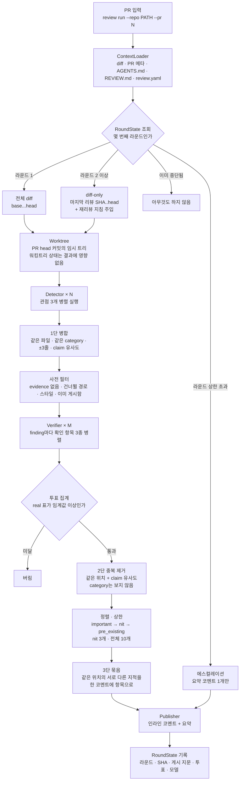

보안 관점을 켜면 탐지와 검증이 두 갈래가 된다(아래 "보안 관점과 보안 검증"). `review.yaml`에
`gate` 블록이 있으면 그 앞에 한 단계가 더 붙는다 — LLM을 부르기 전에 변경 파일 목록만 보고
이번 실행을 건너뛸지, 강도를 올릴지 정한다. 건너뛴 실행은 **라운드를 쓰지 않으므로** 다음
푸시에서 다시 평가된다.

---

## 3. 코드가 결정하는 것 vs LLM이 결정하는 것

흔들리면 안 되는 로직은 LLM에 맡기지 않는다. 아래 왼쪽은 전부 **순수 함수**이고
LLM 없이 단위 테스트된다(테스트 452개).

```mermaid
flowchart LR
    subgraph CODE["코드가 결정 — 순수 함수 · 결정적"]
        direction TB
        C1["1단 병합 · 2단 중복 제거<br/>merger.py + similarity.py"]
        C2["사전 필터<br/>filters.py"]
        C3["투표 집계 · 임계값<br/>filters.py"]
        C4["정렬 · nit 상한 · 게시 상한<br/>filters.py"]
        C5["라운드 판단 · 상한<br/>orchestrator.py"]
        C6["중복 지문 차단<br/>filters.py + state.py"]
        C7["코멘트 묶기<br/>publisher.py"]
    end

    subgraph LLM["LLM이 결정 — 비결정적 · 교체 가능"]
        direction TB
        L1["버그를 찾는다<br/>탐지 3관점"]
        L2["심각도를 매긴다<br/>important · nit · pre_existing"]
        L3["반증을 찾는다<br/>검증 3항목"]
    end

    LLM -->|"후보와 판정만 넘김"| CODE
    CODE -->|"게시 여부는 코드가 결정"| OUT["인라인 코멘트"]
```

---

## 3-b. 병합은 왜 3단인가

같은 결함인지 판단하는 신호는 셋인데 믿을 수 있는 정도가 다르다.

| 신호 | 믿을 수 있는가 |
|---|---|
| 파일·라인 위치 | 믿을 수 있다. 단 한 위치에 서로 다른 버그가 둘 있을 수 있다 |
| `category` | **믿을 수 없다.** 탐지기가 추측한 라벨이라 같은 버그에 `data`/`concurrency`가 갈린다 |
| `claim` 내용 | 믿을 수 있다. 단 표현이 달라 완전 일치를 기대할 수 없다 |

그래서 정체성은 **위치 + 주장 내용**으로 판단하고 category는 보조로만 쓴다.

### 지키는 불변식

1. **정체성 = 위치 + 내용.** 위치만으로도 합치지 않는다.
2. **검증받지 않은 주장은 게시하지 않는다.** 서로 다른 주장을 검증 전에 섞으면 검증자가 두
   주장을 한꺼번에 판정해 투표가 흐려지고, 흡수된 주장은 검증 없이 코멘트에 실린다.
3. **코멘트 수는 줄이고 정보는 줄이지 않는다.** 어느 단계에서도 claim을 버리지 않는다.

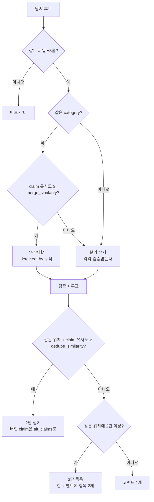

### 네 가지 경우

| 경우 | 1단 | 2단 | 3단 | 결과 |
|---|---|---|---|---|
| 같은 버그, 같은 category, 다른 표현 | 합침 | - | - | 코멘트 1개, `detected_by` 누적 |
| 같은 버그, **다른 category** | 분리 | **접음** | - | 코멘트 1개 |
| **다른 버그, 같은 위치** | **분리** | 분리 | **묶음** | 코멘트 1개, 항목 2개 (둘 다 검증됨) |
| 다른 버그, 다른 위치 | 분리 | 분리 | 분리 | 코멘트 2개 |

3단이 **안전망**이다. 유사도 임계값이 빗나가도 최악의 결과는 "한 코멘트 안에 비슷한 항목 둘"이고
"코멘트 둘"이 아니다. 그래서 임계값 선택의 위험이 낮다.

### 유사도는 실측으로 정했다

`claim`의 **문자 bigram Jaccard**를 쓴다. 한국어는 조사가 붙어 단어 Jaccard가 낮게 나온다
("트랜잭션이" vs "트랜잭션은"). 문자 bigram은 조사와 띄어쓰기 차이에 둔감하다.

임계값은 추측이 아니라 **실제 PR 리뷰 결과 15쌍**(같은 버그 5쌍 / 다른 버그 10쌍)으로 측정했다.

| 비교 대상 | 같은 버그 최저 | 다른 버그 최고 | 간격 |
|---|---|---|---|
| claim만 | 0.243 | 0.122 | +0.120 |
| claim + suggested_fix | 0.229 | 0.152 | +0.077 |

그래서 `suggested_fix`는 **제외한다**. "~하세요" 같은 상투적 문구가 서로 다른 버그끼리도
비슷해 보이게 만들어 간격을 절반 가까이 좁힌다.

설계 단계에서 추측한 값은 0.55였다. 그대로 썼다면 실측 0.243을 한참 넘어 **아무것도 접히지
않았을 것**이다. 합성 예제로 맞춘 임계값은 현장에서 쓸모가 없다.

## 4. 탐지·검증 팬아웃

탐지기는 같은 프롬프트를 N번 돌리지 않고 **관점을 나눈다**.
검증자는 탐지기의 추론 과정을 받지 않고 **finding 하나와 레포만** 받으며,
지적을 지지하는 대신 **반증을 찾도록** 지시받는다.

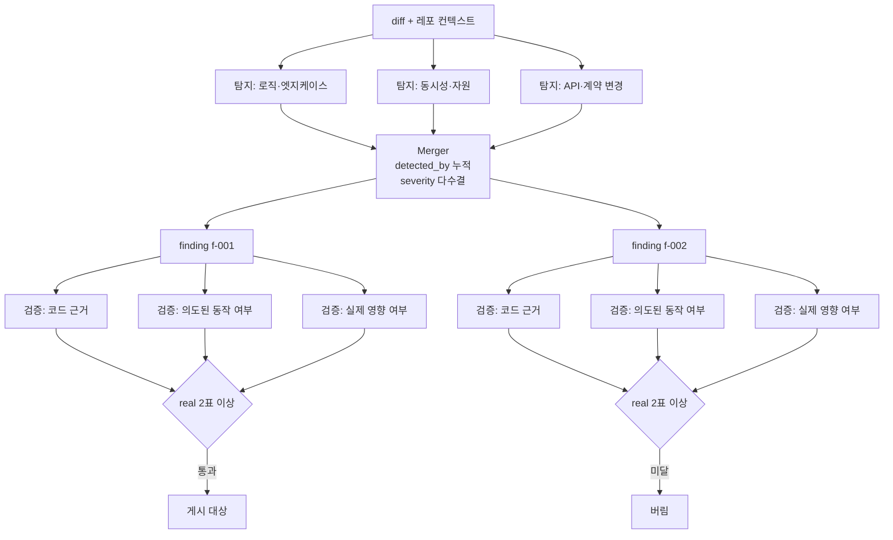

**LLM 호출 수** = `N` + (`병합 후 finding 수` × `M`)
기본값 N=3, M=3이면 후보 2건일 때 3 + 6 = 9회. 전부 `max_parallel`(기본 8) 안에서 병렬 실행.
보안 finding은 M 대신 `security_checks` 수(기본 3)를 쓰고, 결정적 도구가 낸
finding(`deterministic`)은 검증하지 않는다.

### 탐지 관점 (N=3)

| 관점 | 보는 것 |
|---|---|
| 로직·엣지케이스 | 조건 분기 오류, null/빈 값/경계값, 잘못된 계산, 오류 처리 누락, 상태 전이 |
| 동시성·자원 | 경쟁 상태, 트랜잭션 경계, 락/데드락, 리소스 누수, 재시도·멱등성 |
| API·계약 변경 | 요청/응답 필드·타입 변경, 하위 호환 파괴, 호출부 불일치, 스키마·마이그레이션 |

### 검증 확인 항목 (M=3)

| 확인 항목 | 보는 것 |
|---|---|
| 코드 근거 | 인용된 코드가 그 위치에 실제로 있는가, 주장이 그 코드로 성립하는가 |
| 의도된 동작 여부 | PR 설명·컨벤션·테스트에 비추어 의도된 동작이 아닌가, 다른 계층이 이미 처리하지 않는가 |
| 실제 영향 여부 | 이 경로에 도달 가능한가, 도달하면 구체적 영향이 있는가 |

증거가 불충분해 판단할 수 없으면 `not_real`. 출력이 파싱되지 않아도 `not_real`.
**애매하면 닫는 쪽이 기본값이다.**

### 보안 관점과 보안 검증 (기본 꺼짐)

`review.yaml`에 `security_angles`를 적으면 보안 관점이 **범용 관점 위에 덧붙는다**. 관점
하나가 탐지 호출 하나이므로 `[authz, injection, data_exposure]`는 호출을 3 → 6회로 늘린다.
설정을 적지 않은 레포는 지금과 똑같이 동작한다.

| 관점 | id | 보는 것 |
|---|---|---|
| 인증·인가 | `authz` | 인증 없는 엔드포인트, 인가 검사 누락, IDOR, 권한 상승, 역할 검사 우회 |
| 입력 검증·인젝션 | `injection` | SQL·커맨드·XSS·경로 조작·역직렬화·SSRF·템플릿 인젝션 |
| 민감정보 노출 | `data_exposure` | 시크릿 하드코딩, 민감정보 로깅·응답 노출, 취약한 암호화·해시·난수 |
| 권한·설정 변경 | `config` | CORS·쿠키 설정, CI 워크플로 시크릿 노출, 컨테이너·인프라 권한, 새 의존성 |

`category: security` finding은 **다른 확인 항목으로** 검증된다.

| 확인 항목 | 보는 것 | `not_real` 조건 |
|---|---|---|
| 도달 가능성 | 이 값·경로가 신뢰 경계 밖에서 공격자 제어로 들어오는가 | 입구가 내부 호출뿐임을 코드로 확인 |
| 기존 방어 존재 | 이 경로를 막는 방어가 **코드에** 있는가 | 막는 방어를 `파일:라인`으로 찾음 |
| 악용 영향 | 악용 성공 시 무엇이 노출·변경·상승하는가 | 이미 가진 권한·정보를 넘지 못함 |

범용 체크를 그대로 쓰면 안 되는 이유가 여기 있다. "의도된 동작 여부"는 범용 리뷰에서
훌륭한 오탐 필터다 — **버그는 정의상 의도하지 않은 동작**이니까. 취약점은 반대로 거의
전부 의도적으로 작성된, 지금 정상 동작하는 코드다. 일부러 인증을 뺀 내부 엔드포인트,
바인딩이 안 되는 `ORDER BY`의 문자열 결합, 디버깅용 토큰 로깅이 모두 "의도된 동작"으로
판정되어 떨어진다. 그래서 "의도 여부"를 빼고 **도달 가능성 + 코드로 확인되는 방어**로
바꾼다. 오탐 필터가 없어지는 게 아니라 `existing_defense`가 그 자리를 맡는다.

세 항목은 투표가 아니라 **독립적인 필요조건**이다. 그래서 통과 기준이 전원 합의이고
(`security_pass_threshold`, 생략하면 `security_checks` 수), `intensity: deep`으로
`verifiers`를 5로 올려도 보안 검증은 3명 그대로다. 같은 항목을 두 번 뽑으면 그 항목에
가중치가 실려 AND 의미가 깨진다.

게시 단계도 다르다. 정렬만으로 자르면 `important`가 많은 PR에서 보안 지적이 조용히
잘리므로 `security_reserved_slots`만큼 먼저 떼어 주고, 보안 nit은 `important`로 올린다
(`security_severity_floor`).

---

## 5. finding이 걸러지는 깔때기

실제 PR(#153, 13개 파일 +287/−4)을 Codex로 리뷰한 결과다. 숫자는 실행 로그에서 그대로 가져왔다.

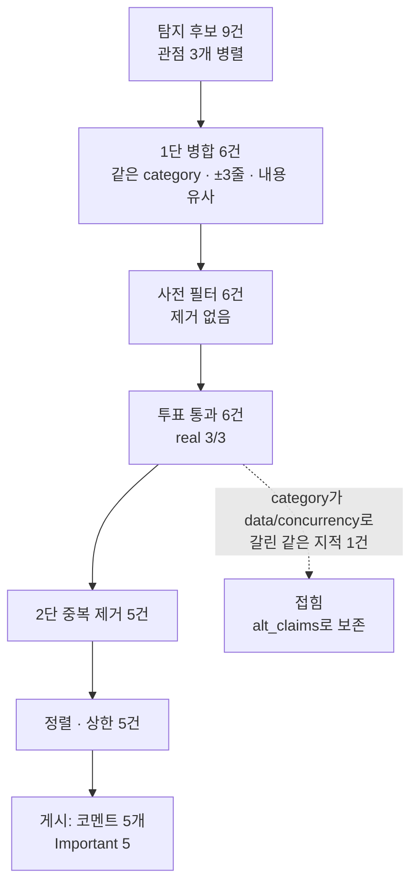

| 단계 | 통과 | 무슨 일이 있었나 |
|---|---|---|
| 탐지 후보 | 9 | 관점 3개가 각각 보고 |
| 1단 병합 | 6 | 같은 버그를 여러 관점이 다르게 서술한 것을 합침 (`detected_by` 누적) |
| 사전 필터 | 6 | 건너뛸 경로·스타일 지적 없었음 |
| 투표 통과 | 6 | 전부 `real` 3/3 |
| **2단 중복 제거** | **5** | `AdminConfirmService:38-44`의 `@Transactional` 누락이 `data`/`concurrency`로 갈려 있던 것을 접음 |
| 정렬·상한 | 5 | 상한에 걸린 것 없음 |
| 게시 | 5 | 코멘트 5개 |

그 중복 1건이 이 설계를 고치게 만든 사례다. 이전 구현은 category를 정체성으로 썼기 때문에
같은 줄의 같은 문제를 코멘트 두 개로 올렸다.

`detected_by`에 몇 개 관점이 찾았는지 기록되므로, 같은 등급 안에서는 **여러 관점이 동시에
찾은 지적이 먼저** 게시된다.

## 6. 수렴 장치: 라운드 상태 머신

에이전트가 작성자이고 에이전트가 리뷰어이면 수십 라운드를 돌 수 있다. 그래서 상한이 필수다.

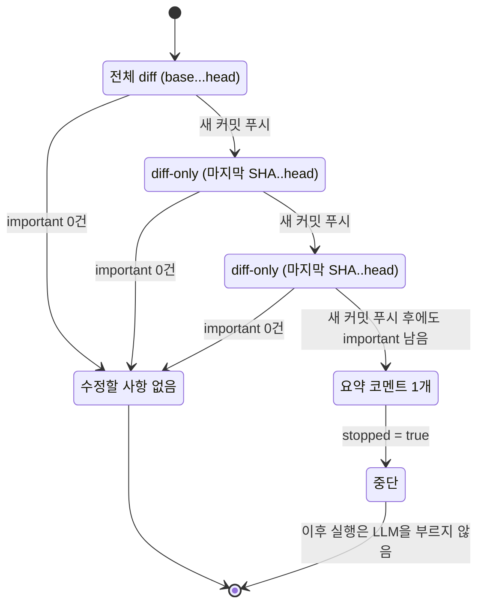

라운드 2 이상에서 적용되는 규칙:

- **범위 축소** — 마지막으로 리뷰한 커밋 이후의 diff만 본다.
- **반복 금지** — 이미 게시한 지적은 **코드 필터와 프롬프트 양쪽**으로 막는다.
- **회귀 우선** — 이번 커밋이 만든 문제와 이전 지적을 고치다 생긴 회귀를 먼저 찾는다.
- **묶어서 지적** — 같은 유형의 버그는 모든 인스턴스를 하나의 finding으로 묶는다.
  한 줄씩 여러 라운드에 걸쳐 지적하지 않게 하려는 장치다.

상한을 넘기면 개별 코멘트 대신 "접근 방식을 다시 검토해 보라"는 요약 하나만 남기고
그 PR을 중단한다. 추적 지표로 PR별 **rounds-to-pass**를 기록한다.

---

## 7. 모듈 구조

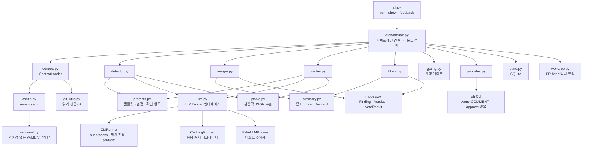

| 모듈 | 역할 |
|---|---|
| `cli.py` | 진입점. `run` / `show` / `feedback` |
| `orchestrator.py` | 단계 연결, 라운드·상한 정책 (`plan_round`, `plan_publish`는 순수 함수) |
| `context.py` | diff, PR 메타데이터, `AGENTS.md`(없으면 `CLAUDE.md`), `REVIEW.md` 파싱 |
| `config.py` / `miniyaml.py` | `review.yaml` 로더. 외부 의존성 없이 동작 |
| `prompts.py` | 탐지·검증·재리뷰 프롬프트 템플릿, 관점·확인 항목 정의 |
| `llm.py` | `LLMRunner` 인터페이스와 백엔드 구현 |
| `jsonio.py` | CLI가 로그를 섞어 내보내도 균형 맞는 JSON 구간을 찾아 파싱 |
| `detector.py` | 관점별 실행, JSON 스키마 검증, 파싱 실패 1회 재시도 |
| `merger.py` | 1단 병합(유사도 게이트), 2단 중복 제거, `detected_by` 누적, severity 다수결 |
| `similarity.py` | claim의 문자 bigram Jaccard. 임계값은 실측으로 정함 |
| `worktree.py` | PR head 커밋의 임시 트리 생성·정리 |
| `verifier.py` | finding별 검증자 병렬 실행, 투표 수집 |
| `filters.py` | 사전 필터 → 임계값 → 정렬 → 상한(보안 슬롯 예약 포함) |
| `gating.py` | 변경 파일 목록으로 실행 여부와 강도를 정하는 실행 게이트 (`review.yaml`의 `gate`) |
| `state.py` | 라운드 수, 마지막 리뷰 SHA, 게시 지문, 투표 결과, 피드백 로그 |
| `publisher.py` | 3단 묶음, 인라인 코멘트 + 요약 게시, `--dry-run` 출력 |

---

## 8. LLM 백엔드 교체 지점

탐지와 검증은 **모두 하나의 인터페이스**로만 LLM을 부른다.

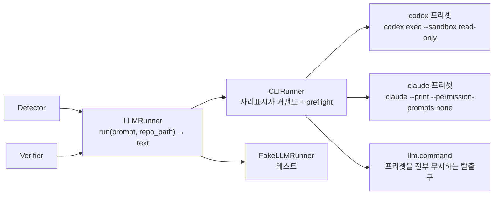

- API 키, HTTP 클라이언트, SDK가 **코드에 없다.** 인증과 모델 선택은 CLI에 맡긴다.
  그래서 비밀값이 코드와 로그에 남지 않는다.
- 모든 LLM 호출은 **읽기 전용**이다. 파일 수정과 네트워크 접근을 허용하지 않는다.
  codex는 `--sandbox read-only`, claude는 `--permission-prompts none`(승인이 필요한
  동작은 묻지 않고 거부) + `--disallowedTools`로 보장한다.
- `CLIRunner`는 백엔드 중립적이다. 커맨드가 자리표시자 기반이라 클래스가 아니라
  **데이터**로 백엔드를 바꾼다. 백엔드를 추가하는 비용은 `BACKEND_PRESETS`에 항목 하나다.

| 자리표시자 | 뜻 |
|---|---|
| `{repo}` | 대상 레포 경로 |
| `{out}` | 임시 파일 경로. CLI가 그 파일에 쓴 최종 메시지를 응답으로 쓴다. 비어 있으면 stdout으로 되돌아간다 |
| `{model}` / `{effort}` | `llm.model` / `llm.reasoning_effort` |
| `-` | 프롬프트를 stdin으로 보낸다. 토큰은 argv에 **남는다**(codex의 위치 인자) |
| `{stdin}` | 프롬프트를 stdin으로 보내고 토큰은 argv에서 **제거한다**(claude) |

아무 표시자도 없으면 프롬프트를 마지막 인자로 붙인다.

`{out}`이 필요한 이유: `codex exec`는 stdout에 진행 로그와 **프롬프트 에코**까지 섞어
내보낸다. 최종 메시지만 파일로 받으면 그 잡음을 아예 피한다. `claude --print
--output-format text`는 stdout에 최종 응답만 내므로 `{out}`을 쓰지 않는다.

`-`와 `{stdin}`을 나눈 이유: codex는 `-`라는 위치 인자를 **보고** stdin을 읽지만, claude는
그런 표시자가 없고 파이프만으로 읽는다. 하나로 합치면 claude argv에 `-`가 남아 프롬프트
문자열로 해석된다.

### 백엔드와 프로필

백엔드는 **어떤 CLI를 부를지**, 프로필은 **어떻게 인증하고 무엇을 고정할지** 정한다.
프로필을 따로 둔 이유는 로컬과 CI의 인증 경로가 다르기 때문이다 — 로컬은 대화형 로그인
(구독 크레딧), CI는 환경변수(키/토큰)뿐이고 대화형 로그인을 할 수 없다.

| | `local` | `ci` |
|---|---|---|
| 감지 | 기본값 | `CI` / `GITHUB_ACTIONS` 환경변수 |
| codex 인증 | `codex login` (구독) | `codex login --with-api-key` |
| codex 추가 인자 | `--ignore-user-config` | `+ --ephemeral` |
| claude 인증 | `claude auth login` (구독) | `ANTHROPIC_API_KEY` / `CLAUDE_CODE_OAUTH_TOKEN` |
| claude 추가 인자 | `--safe-mode` | `+ --no-session-persistence` |

해석은 `config.resolve_llm`이 한다. **순수 함수**이고 `env`를 주입받으므로 테스트가 실제
환경변수를 건드리지 않는다. 여러 번 불러도 결과가 같다(`explicit` 집합이 보존되므로).

### preflight: 인증을 먼저 막는다

인증이 안 된 상태로 바로 호출하면 `exit 1`과 섞인 stderr만 남아 원인을 알 수 없다.
`CLIRunner.preflight`가 첫 호출 **전에** 한 번 확인한다.

1. 실행 파일이 PATH에 있는지
2. `auth_env`(키/토큰) 중 하나가 환경에 있으면 통과 — 프로필과 무관하다
3. 없고 프로필이 `ci`면 즉시 중단. 대화형 로그인이 불가능하므로 기다릴 이유가 없다
4. 없고 `local`이면 `codex login status` / `claude auth status`를 돌려 로그인 여부를 본다

`llm.command`를 직접 적었으면 어떤 CLI인지 알 수 없으므로 1단계까지만 한다.
로그인 확인 커맨드가 실패하거나 시간을 초과하면 **통과시킨다** — 확인 수단의 문제로
리뷰를 막지 않는다.

### 구조화 출력은 아직 쓰지 않는다

codex-cli 0.167에는 `--output-schema <FILE>`(JSON Schema로 최종 응답 형태 강제)가 있다.
지금은 쓰지 않고 **프롬프트로 "JSON만 출력"을 강제하고 파싱 실패 시 1회 재시도**하는 쪽을
기본으로 둔다. 이유는 둘이다.

1. 백엔드마다 지원 여부와 스키마 제약(루트가 객체여야 하는 등)이 달라, 엔진이 특정 CLI
   버전에 묶인다.
2. `jsonio.py`의 관용적 파싱으로 이미 충분히 안정적이다.

나중에 붙일 때는 `llm.output_schema` 설정으로 **옵션**으로 두는 쪽이 맞다.

---

## 8-b. 같은 입력에 같은 결과를 얻기

같은 PR을 두 번 리뷰했을 때 결과가 달랐다. 원인을 하나씩 끊은 결과는 이렇다.

| 비결정성 원인 | 대응 | 가능? |
|---|---|---|
| 모델 버전 변동 | `-c model=<고정>` (`llm.model`) | ✅ |
| 추론 강도 변동 | `-c model_reasoning_effort=<고정>` | ✅ |
| 사용자 개인 설정 상속 | 명시적 `-c`가 `~/.codex/config.toml`을 이김 (+ codex `--ignore-user-config` / claude `--safe-mode`, 프로필 기본값) | ✅ |
| 리뷰 대상 파일 상태 | PR head 커밋의 임시 worktree | ✅ |
| 라운드 상태 | A/B 비교 시 새 `--state` 파일 | ✅ |
| 백엔드 변동 | 캐시 스코프에 `llm.backend` 포함 (바꾸면 의도대로 빗나간다) | ✅ |
| 실행 순서 | 순수 함수 + 정렬 타이브레이크에 `id`까지 포함 | ✅ 이미 됨 |
| 완전 재현 | 응답 캐시 (`--cache`) | ✅ |
| **샘플링(temperature)** | **Codex CLI에 노출 안 됨** | ❌ 불가 |

### 모델을 고정하지 않으면 결과가 조용히 바뀐다

`codex exec`에 `-c model=`을 주지 않으면 사용자의 `~/.codex/config.toml`을 상속한다. ChatGPT
앱에서 모델이나 추론 강도를 바꾸는 순간 리뷰 품질이 달라지고, 그 사실이 어디에도 남지 않는다.
그래서 기본값으로 둘 다 커맨드에 박고, 사용한 모델을 상태 DB에 함께 기록한다.

### 리뷰 대상 트리: diff와 파일이 같은 시점이어야 한다

`git diff base...head`는 히스토리에서 나오지만, 탐지 프롬프트는 "호출처와 연관 파일을 열어
보라"고 지시하므로 LLM은 **체크아웃된 파일**을 읽는다. 둘이 다른 시점이면 인용 라인 번호가
diff와 어긋나 인라인 코멘트가 엉뚱한 줄에 붙고, 워킹트리가 바뀔 때마다 결과가 달라진다.

실측 예: PR #153의 head와 당시 워킹트리는 **128개 파일 / +710 −518** 차이였다. 그 리뷰가
인용한 `ConfirmBlockHistory.java`는 4줄, `application.yml`은 3줄 달랐다.

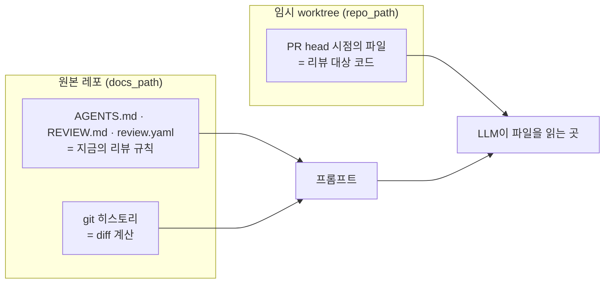

문서를 원본에서 읽는 것이 중요하다. 리뷰 규칙은 "리뷰 대상 코드"가 아니라 "지금 적용할 규칙"이고,
커밋하지 않은 `REVIEW.md`도 읽혀야 한다(worktree에는 untracked 파일이 없다).

CI도 같은 기준이어야 한다. `pull_request` 이벤트의 `actions/checkout` 기본값은 **머지 커밋**이라
`ref: ${{ github.event.pull_request.head.sha }}`를 명시해야 로컬과 결과가 갈리지 않는다.

### 남는 분산

샘플링은 끌 수 없으므로 캐시 없이는 매번 조금씩 다르다. 그래서 **투표 임계값과 상한이
존재한다** — 분산을 흡수하는 장치다. 더 줄이려면 `verifiers`를 늘리거나 `pass_threshold`를
올린다(`intensity: deep` = 3/5/3). 근본적인 답은 eval 세트이고, 그건 범위 밖이다.

## 9. 레포별 컨텍스트 주입

엔진에 프로젝트별 하드코딩을 넣지 않는다. 오탐이 반복되면 엔진이 아니라 **대상 레포의
설정 파일**을 고친다.

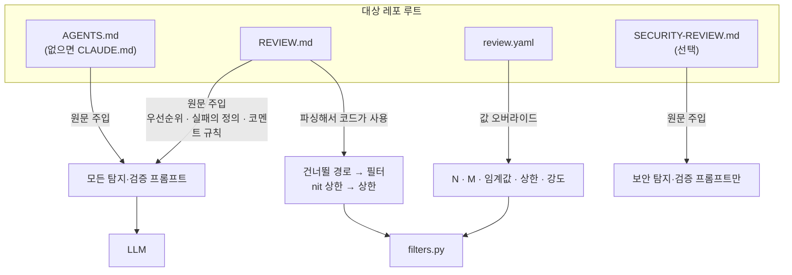

| 파일 | 쓰임 | 없으면 |
|---|---|---|
| `AGENTS.md` / `CLAUDE.md` | 프로젝트 소개, 스택, 빌드·테스트 명령, 컨벤션, 목표/비목표 | 프롬프트에 "없음" 표시 후 기본 지침으로 진행 |
| `REVIEW.md` | 리뷰어용 지침. `건너뛸 경로`와 `nit 상한`은 **코드가 직접** 파싱 | 기본값 (nit 3개, 건너뛸 경로 없음) |
| `SECURITY-REVIEW.md` | 인증 방식, 금지 API, 데이터 분류, 알려진 예외. **보안 프롬프트에만** 원문 주입 | 일반적인 보안 통념으로만 판단 |
| `review.yaml` | N, M, 임계값, 상한, 강도, 코멘트 언어, 보안 관점, 실행 게이트 오버라이드 | 전부 기본값 (보안 리뷰는 꺼짐) |

nit 상한 우선순위: **`review.yaml` 명시값 → `REVIEW.md` → 기본값 3**

### 리뷰 강도 프리셋

| intensity | detectors (N) | verifiers (M) | pass_threshold | reasoning_effort |
|---|---|---|---|---|
| `quick` | 1 | 1 | 1 | `low` |
| `standard` | 3 | 3 | 2 | `medium` |
| `deep` | 3 | 5 | 3 | `high` |

`intensity`는 호출 수와 **호출당 추론 강도를 함께** 정한다. `llm.reasoning_effort`를 직접
적으면 그 값이 이긴다. 보안 검증자 수는 `intensity`를 따라가지 않는다(위 "보안 관점과
보안 검증").

---

## 10. 데이터 모델

### finding 스키마

LLM이 내보내는 JSON 항목. `evidence`(파일:라인 + 코드 인용)는 필수이며, 비어 있으면
스키마 검증 단계에서 제거된다.

| 필드 | 값 |
|---|---|
| `file` | 레포 루트 기준 상대 경로 |
| `line_start`, `line_end` | 라인 범위 |
| `category` | `logic` · `concurrency` · `api_contract` · `security` · `data` · `other` |
| `severity` | `important` · `nit` · `pre_existing` |
| `claim` | 무엇이 어떻게 잘못되는지 1~2문장 |
| `evidence` | 파일:라인 + 근거 코드 인용 (**필수**) |
| `suggested_fix` | 수정 방향 1~2문장 |
| `detected_by` | 어떤 관점들이 찾았는지 (엔진이 기록) |

지문(fingerprint) = `파일:라인범위:category` — 라운드 간 중복 게시를 막는 키다.

### 심각도

| severity | 뜻 | 처리 |
|---|---|---|
| `important` | 꼭 고쳐야 할 진짜 문제 | 최우선 게시. 라운드 상한 판단 기준 |
| `nit` | 동작엔 문제없는 사소한 지적 | PR당 상한 적용 (기본 3개) |
| `pre_existing` | 이 PR이 만들지 않은 기존 문제 | 작성자 탓처럼 보이지 않게 구분해 게시 |

심각도는 탐지기가 태깅하고, 병합 시 **더 높은 등급으로 올리지 않고 다수결**로 정한다.

### 상태 저장소 (SQLite 파일 하나)

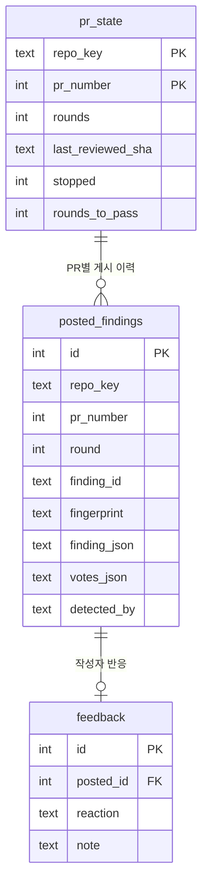

`feedback.reaction` = `fixed` · `wrong` · `intentional` · `ignored`
나중에 오탐률을 세고 eval 세트를 만들기 위한 씨앗이다.

---

## 11. 실행 환경

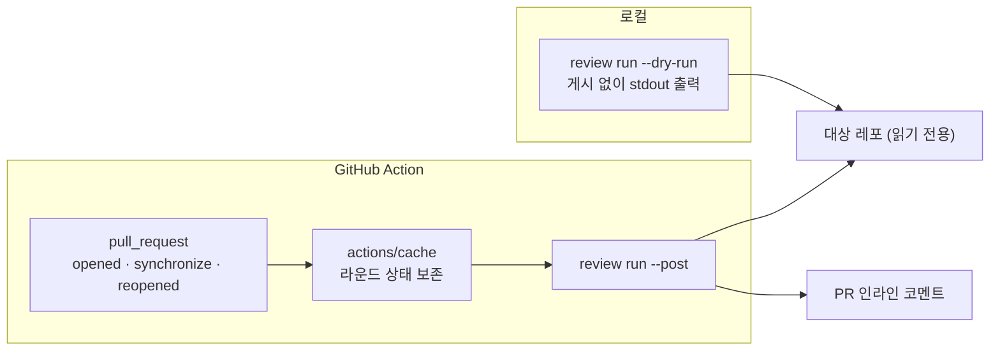

- `--dry-run`이 **기본값**이다. 게시는 되돌리기 어려운 동작이라 `--post`를 명시해야 올라간다.
- 프로필은 환경변수로 자동 감지하되, 워크플로우는 `--profile ci`를 **명시한다**. 읽는 사람이
  동작을 바로 알 수 있어야 하고, 러너 환경변수가 바뀌어도 흔들리지 않는다.
- 백엔드는 레포 변수 `REVIEW_BACKEND`로 고른다. 그 값에 맞는 설치·인증 단계만 돈다.
- CI에서는 `fetch-depth: 0`(전체 히스토리)과 **상태 파일 보존**이 필수다. 상태가 남지 않으면
  매 실행이 라운드 1이 되어 이전 지적을 다시 올린다.
- CI 체크아웃은 `ref: ${{ github.event.pull_request.head.sha }}`를 명시한다. `pull_request`
  이벤트의 기본값은 **머지 커밋**이라 그대로 두면 로컬(PR head 기준)과 결과가 갈리고 인라인
  코멘트의 `commit_id`와도 어긋난다.
- 게시는 `event=COMMENT`까지만 한다. **approve는 구현하지 않는다.**

---

## 12. 범위 밖 (의도적으로 넣지 않은 것)

| 넣지 않은 것 | 이유 |
|---|---|
| 사고 기반 eval 세트 자동화 | 피드백 로그 구조만 준비. 데이터가 쌓인 뒤에 만든다 |
| 위험도 분류기, 승인 정책, 머지 큐 | MVP 범위 밖 |
| 별도 워크플로로 분리된 보안 리뷰 | 같은 파이프라인 안의 관점으로 넣는다. 분리하면 `(repo_key, pr_number)` 라운드 상태가 충돌하고 범용·보안 사이 교차 중복 제거가 사라진다 |
| 결정적 보안 도구(gitleaks·Semgrep) 연동 | 확장 지점만 둔다. `Finding.deterministic`이 참이면 LLM 검증을 건너뛰므로, 도구 출력을 `Finding`으로 바꾸는 어댑터만 쓰면 붙는다 |
| 자동 수정(fix) 에이전트 | 리뷰와 수정을 한 에이전트가 하면 수렴 판단이 어려워진다 |
| approve 동작 | 머지 결정은 사람이 한다 |

---

참고: [Solving code review at Anthropic](https://claude.dev/blog/solving-code-review-at-anthropic/)
